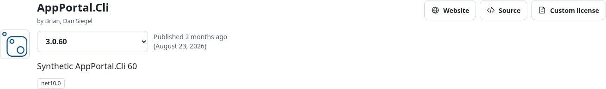
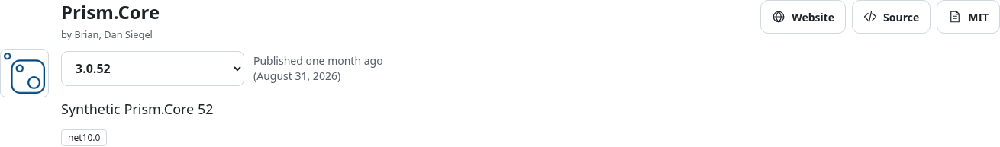
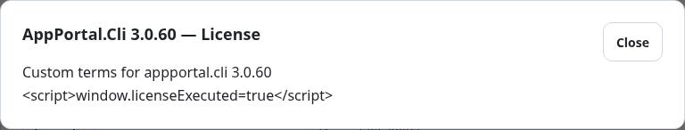
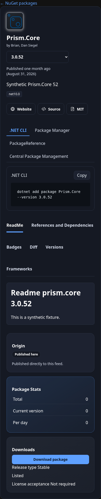

# Synthetic package-details screenshot evidence

These screenshots come from the committed loopback browser fixture. Package metadata, versions and license text are generated test inputs, not live feed measurements or private package contents.

## AppPortal.Cli header



## Prism.Core header



## Custom-license modal



## Narrow dark layout



Reproduce from the repository root while the fixture is running:

```sh
python scripts/profile-package-detail.py --url http://127.0.0.1:5187 --screenshots-dir docs/recovery/package-details-ui-fixtures
```
